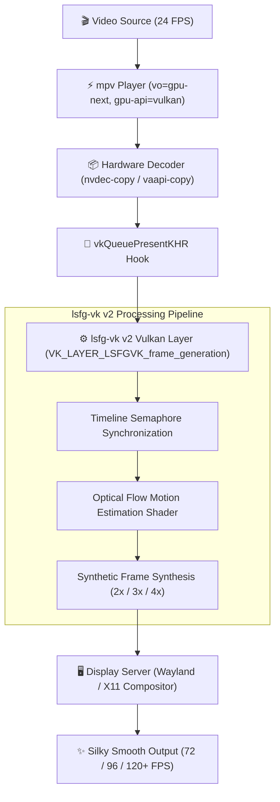

<div align="center">

# 🎬 Lossless Scaling Frame Generation (lsfg-vk v2) for mpv on Linux

<p align="center">
  <strong>Transform 24 FPS movies and 30/60 FPS videos into silky-smooth 72 FPS / 96 FPS / 120+ FPS playback on Linux using native Vulkan swapchain frame generation.</strong>
</p>

[](https://archlinux.org)
[](https://www.vulkan.org/)
[](https://mpv.io)
[](https://wayland.freedesktop.org/)
[](https://www.nvidia.com/)
[](LICENSE)

<br/>

[✨ Features](#-features) • [⚡ Quick Start](#-quick-start) • [🚀 Usage & Presets](#-usage--cli-options) • [⚙️ Configuration](#-configuration) • [🏗️ Architecture](#-how-it-works) • [🛠️ Troubleshooting](#-troubleshooting)

<hr style="border: 0; height: 1px; background-image: linear-gradient(to right, rgba(0, 0, 0, 0), rgba(255, 255, 255, 0.4), rgba(0, 0, 0, 0));"/>

</div>

## ✨ Features

<table>
  <tr>
    <td width="50%">
      <h3>🚀 2x, 3x & 4x Multipliers</h3>
      <p>Seamlessly boost 24 FPS cinema videos to <b>48 FPS</b>, <b>72 FPS</b>, or <b>96 FPS</b> on high-refresh 120Hz/144Hz/240Hz monitors.</p>
    </td>
    <td width="50%">
      <h3>⚡ Native Vulkan Swapchain Hook</h3>
      <p>Direct <code>vkQueuePresentKHR</code> interception with Vulkan compute pipelines. No Wine/Proton virtualization overhead.</p>
    </td>
  </tr>
  <tr>
    <td width="50%">
      <h3>📺 YouTube & URL Streaming</h3>
      <p>Built-in streaming integration with optimal cache buffering: simply run <code>lsfg yt "URL"</code>.</p>
    </td>
    <td width="50%">
      <h3>🎛️ Modern v2 Architecture</h3>
      <p>Full support for the modern <code>lsfg-vk</code> v2 engine, profile-based configuration, FP16 compute shaders, and automated layer management.</p>
    </td>
  </tr>
</table>

---

## ⚡ Quick Start

### 1. Prerequisites

1. **Install required packages** (Arch Linux / CachyOS):
   ```bash
   sudo pacman -S mpv vulkan-tools yt-dlp
   yay -S lsfg-vk-git   # or paru -S lsfg-vk-git
   ```

2. **Steam Lossless Scaling Beta Branch**:
   To obtain the native Vulkan shader library (`lsfg-vk.dll`):
   - Open your **Steam Library**.
   - Right-click **Lossless Scaling** → **Properties...**
   - Go to **Betas** (or *Game Versions & Betas*).
   - Select the **`lsfg-vk`** beta branch from the dropdown menu.
   - Let Steam download the files. This places `lsfg-vk.dll` in your Steam directory.

### 2. Automated 1-Click Setup

```bash
# Clone this repository
git clone git@github.com:punitr2007/lsfg-mpv-interpolation-configs.git
cd lsfg-mpv-interpolation-configs

# Run the installer
./install.sh
```

The installer will:
- Check for `mpv` and the `lsfg-vk` Vulkan layer.
- Auto-detect `lsfg-vk.dll` from your Steam installation.
- Deactivate obsolete v1 implicit layers to prevent loader collisions.
- Generate a clean `~/.config/lsfg-vk/conf.toml` (v2 schema).
- Install the `lsfg` launcher to `~/.local/bin/lsfg`.
- Configure `~/.config/mpv/mpv.conf` with the optimal `[lsfg]` profile.

### 3. Enjoy Silky-Smooth Playback!

```bash
# 24 FPS Cinema -> 72 FPS on 120Hz/144Hz screens:
lsfg -m 3 -f 1.0 mpv /path/to/movie.mkv

# 24 FPS Anime -> 96 FPS on 144Hz/240Hz screens:
lsfg -m 4 -f 1.0 mpv anime.mkv

# Stream YouTube with 3x frame interpolation:
lsfg yt "https://www.youtube.com/watch?v=dQw4w9WgXcQ"
```

---

## 🚀 Usage & CLI Options

The `lsfg` launcher wraps `mpv` and manages Vulkan layer states, configuration updates, and hardware decoding.

```
lsfg [options] <command> [args...]
```

### 🎯 Presets & Common Workflows

```bash
# 🍿 1. Cinematic 3x Interpolation (24 FPS -> 72 FPS at maximum quality)
lsfg -m 3 -f 1.0 mpv movie.mkv

# ⚡ 2. High-Refresh 4x Interpolation (24 FPS -> 96 FPS for 144Hz+ displays)
lsfg -m 4 -f 1.0 mpv anime.webm

# 📺 3. YouTube Stream Interpolation (Auto buffer & performance tuning)
lsfg yt "https://www.youtube.com/watch?v=..."

# 🔋 4. Low-Power / Battery Saver Mode (Lightweight flow pass for laptops)
lsfg -m 2 -f 0.5 -p mpv video.mkv

# 🐞 5. Verbose Debug Mode (Print layer diagnostics and shader loads)
lsfg -d mpv video.mkv
```

### 📋 CLI Flags Reference

| Flag | Parameter | Values | Default | Description |
| :--- | :--- | :--- | :--- | :--- |
| **`-m, --multiplier`** | `multiplier` | `2`, `3`, `4` | `3` | Target frame multiplication factor (e.g. $24 \times 3 = 72$ FPS) |
| **`-f, --flow-scale`** | `flow_scale` | `0.25` – `1.0` | `1.0` | Optical flow vector resolution ($1.0$ = highest fidelity) |
| **`-p, --performance`** | `performance_mode` | toggle | `false` | Enables lightweight compute shaders to conserve GPU power |
| **`--pacing`** | `pacing_mode` | `vsync` | `vsync` | Frame pacing and insertion method |
| **`--dll`** | `dll` | `/path/...` | *Steam default* | Custom path to `lsfg-vk.dll` or `Lossless.dll` |
| **`-d, --debug`** | `log_level` | toggle | `info` | Enables verbose debug output (`LSFGVK_LOG_LEVEL=debug`) |
| **`--help`** | | | | Display quick command-line reference |

---

## ⚙️ Configuration

### 📄 `~/.config/lsfg-vk/conf.toml` (v2 Schema)

```toml
version = 2

[global]
# Path to lsfg-vk.dll from Steam Beta branch 'lsfg-vk'
dll = "/home/username/.local/share/Steam/steamapps/common/Lossless Scaling/lsfg-vk.dll"

# Half-precision FP16 acceleration for modern GPUs (RTX, RDNA)
allow_fp16 = true

# Log level: "debug", "info", "warning", "error"
log_level = "info"

# Application Profile for mpv
[[profile]]
name = "mpv"
active_in = ["mpv"]

# Frame rate multiplier (2x, 3x, 4x)
multiplier = 3

# Optical flow precision scale (0.25 to 1.0)
flow_scale = 1.0

# Lightweight shader execution mode
performance_mode = false

# Presentation pacing and VSync override
pacing_mode = "vsync"
override_present_mode = true
```

> [!IMPORTANT]
> The modern `lsfg-vk` v2 engine strictly requires `version = 2` and profile blocks defined with `[[profile]]` and `active_in = ["mpv"]`. Older v1 syntax (`[[game]] exe = "mpv"`) will trigger syntax errors. The `lsfg` launcher and installer automatically ensure the v2 schema is used.

---

### 🎛️ `~/.config/mpv/mpv.conf` (Profile `[lsfg]`)

The installer automatically adds the `[lsfg]` profile to your mpv configuration:

```ini
[lsfg]
vo=gpu-next
gpu-api=vulkan
hwdec=nvdec-copy
hwdec-codecs=all
interpolation=no
video-sync=audio
```

> [!TIP]
> - `hwdec=nvdec-copy` (or `vaapi-copy` on AMD/Intel) prevents GPU device context deadlocks between hardware video decoders and the Vulkan swapchain.
> - `interpolation=no` ensures mpv's internal software resampler does not interfere with the Vulkan swapchain frame generation layer.

---

## 🏗️ How It Works



For full architectural details, read [docs/ARCHITECTURE.md](docs/ARCHITECTURE.md).

---

## 🛠️ Troubleshooting

<details>
<summary><b>🔍 1. Why does mpv OSD or MangoHud still show 24 FPS?</b></summary>
<br>
mpv's OSD (and stats overlays like MangoHud placed upstream in the loader chain) measure the <b>upstream decoder clock</b> before Vulkan presentation. The <code>lsfg-vk</code> layer intercepts the presentation queue (<code>vkQueuePresentKHR</code>) <i>after</i> mpv submits each frame and injects synthetic intermediate frames into the swapchain at 72 FPS or 96 FPS. You can observe the interpolation directly in video smoothness, or run with <code>lsfg -d mpv ...</code> to inspect the layer output logs.
</details>

<details>
<summary><b>⚠️ 2. Error: <code>Unable to find base shader 'mipmaps' in DLL</code>?</b></summary>
<br>
This indicates that the layer is reading the Windows Direct3D <code>Lossless.dll</code> instead of the native Vulkan <code>lsfg-vk.dll</code>.
<br><br>
<b>Fix</b>: Switch to the <b><code>lsfg-vk</code></b> beta branch in Steam:
<ol>
  <li>Open Steam → Right-click <b>Lossless Scaling</b> → <b>Properties...</b></li>
  <li>Go to the <b>Betas</b> tab.</li>
  <li>Select <b><code>lsfg-vk</code></b> in the dropdown.</li>
  <li>Steam will download <code>lsfg-vk.dll</code>.</li>
</ol>
</details>

<details>
<summary><b>⚠️ 3. Error: <code>Unsupported configuration version (must be 2)</code>?</b></summary>
<br>
Your <code>~/.config/lsfg-vk/conf.toml</code> is using the deprecated v1 format. Re-run <code>./install.sh</code> or replace the file with the provided <code>config/lsfg-vk/conf.toml</code>.
</details>

<details>
<summary><b>💥 4. Black screen or crash on startup with NVIDIA?</b></summary>
<br>
Ensure your <code>mpv.conf</code> uses copy-back hardware decoding (<code>hwdec=nvdec-copy</code>) rather than direct CUDA headless decoding. Direct CUDA handles can cause device resource race conditions with Vulkan swapchains.
</details>

For more in-depth solutions, check out [docs/TROUBLESHOOTING.md](docs/TROUBLESHOOTING.md).

---

## 📂 Repository Layout

```
lsfg-mpv-interpolation-configs/
├── bin/
│   └── lsfg                               # Universal launcher script (v2 engine)
├── config/
│   ├── lsfg-vk/
│   │   ├── conf.toml                      # v2 config template with mpv profile
│   │   └── conf.toml.example              # Multi-game / multi-app config template
│   ├── mpv/
│   │   ├── mpv.conf                       # Complete mpv config with [lsfg] profile
│   │   └── profiles/
│   │       └── lsfg.conf                  # Modular include-able profile snippet
│   └── vulkan/
│       ├── VkLayer_LSFGVK_frame_generation.json # Modern v2 Vulkan layer manifest
│       └── VkLayer_LS_frame_generation.json     # Legacy v1 Vulkan layer manifest
├── docs/
│   ├── ARCHITECTURE.md                    # Technical deep dive into layer hooking
│   ├── BENCHMARKS_AND_PRESETS.md          # Multiplier & performance presets
│   └── TROUBLESHOOTING.md                 # Common gotchas and fixes
├── install.sh                             # 1-click automated installer
├── LICENSE                                # MIT License
└── README.md                              # Main documentation
```

---

## 📜 License & Credits

- Distributed under the **MIT License**. See [LICENSE](LICENSE) for more information.
- Created for the Linux media & gaming community. Powered by **[Lossless Scaling](https://store.steampowered.com/app/993090/Lossless_Scaling/)** and **[`lsfg-vk`](https://lsfg-vk.dev)**.
